<p align="center">
  
</p>

<h1 align="center">MyCowork</h1>

<p align="center">
  <strong>A desktop office agent that also works inside your business apps</strong><br />
  File delivery · Single / multi-agent · Skills and connectors · Automations · Industry apps
</p>

<p align="center">Electron · React · FastAPI · Deep Agents · OfficeCLI</p>
<p align="center"><a href="./README.md">中文</a> · <strong>English</strong></p>

MyCowork is a desktop office agent for macOS and Windows. Describe a task and select a workspace: the assistant can use local files and tools, create Word, Excel, PowerPoint, PDF and Markdown deliverables, and show the results in the same window. The industry workbench brings business pages, data and AI tools into the desktop app.

Execution and storage center on your computer. Models can use cloud APIs or local inference services. **With a cloud model, the task content supplied to the model is sent to the configured service.** Local execution does not imply that all content stays on your device.

This README describes the **current 0.1.6 source** (2026-10-27). Screenshots use real UI components with isolated sample data and Chinese labels. Example conversations, automation records and model configurations do not demonstrate real executions or successful connections. See [screenshot maintenance](docs/screenshots/README.md).

## Interface and capabilities

Start from “New task” (新建任务), choose a model and workspace, and use the sidebar to manage projects, tasks, assistants, automations and the workbench.

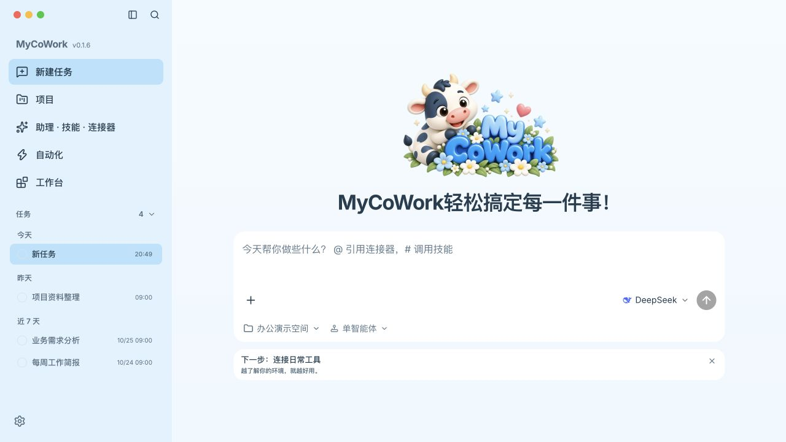

| Capability | Available in the current implementation |
| --- | --- |
| Tasks and projects | Workspaces, projects and sessions; history, task steps, execution details, delivered files and previews |
| Single / multi-agent | Direct task execution or delegation to Deep Agents subagents for documents, browsing and development; complex tasks can request plan approval |
| Office assistants | 10 assistants covering documents, presentations, spreadsheets, official documents, financial models, legal work and mixed-format delivery |
| Skills and memory | Local and bundled skills, a skill store, agent access scopes, on-demand skill loading and managed persistent memory |
| Connectors and browsing | MCP tools, browser reading and interaction, file uploads and screenshots |
| Automations | Visual schedules, manual runs, pause, run history, permissions and recovery review |
| Industry workbench | ZIP apps containing a business UI, Python backend, agent tools and bundled skills |
| Remote channels | Feishu/Lark long connections and WeChat ClawBot QR sign-in; Telegram and DingTalk are currently marked “coming soon” |

### Conversation, delivery and preview

Results can be saved as real files in the workspace. File cards, execution details and the preview panel let you inspect and revise deliverables. This example shows a Markdown weekly report.

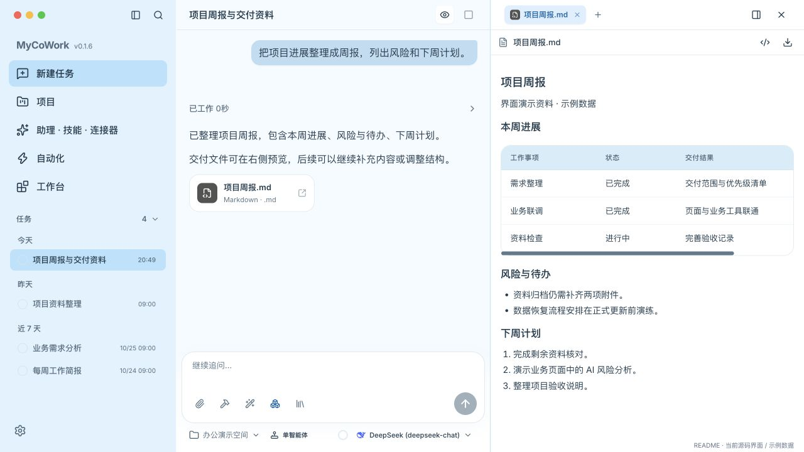

Office documents primarily use bundled [OfficeCLI](https://github.com/iOfficeAI/OfficeCLI) for generation and preview. The repository also includes tools based on `python-docx`, `python-pptx` and `openpyxl`. Available formats and preview fidelity depend on the tool and environment.

Switch execution mode beside the composer. The runtime uses official `create_deep_agent()` and subagents; the product layer provides plan confirmation, operation approval, task state and artifact registration.

<details>
<summary>Show the multi-agent entry point</summary>

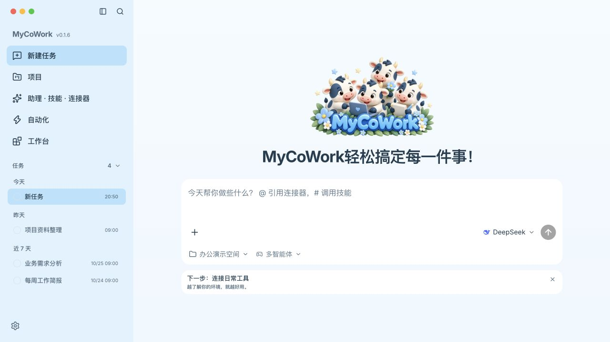

</details>

### Assistants, skills and connectors

“Assistants · Skills · Connectors” (助理 · 技能 · 连接器) provides assistants, skill switches, the skill store, memory and MCP connectors. Choosing an assistant brings in its skills and suggested prompts.

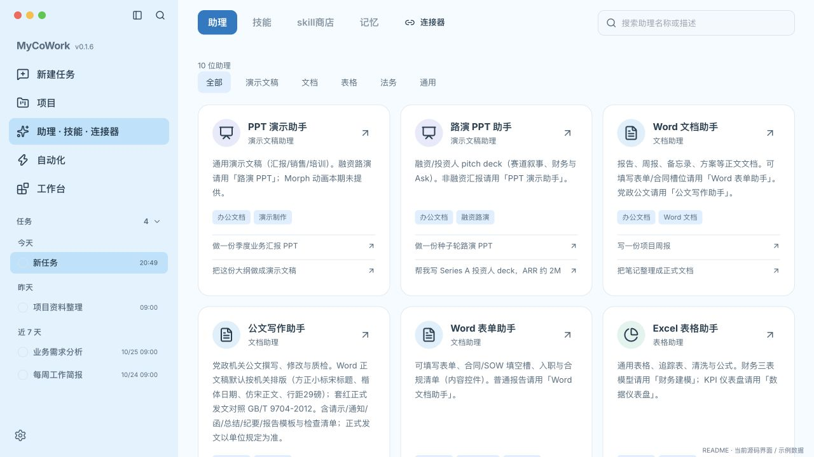

| Category | Assistants | Typical tasks |
| --- | --- | --- |
| Presentations | Presentation, pitch deck | Business reports, training, fundraising decks |
| Documents | Word, official documents, Word forms | Reports, drafts, fillable forms |
| Spreadsheets | Excel, data dashboard, financial modeling | Trackers, KPI dashboards, forecasts |
| Legal | China legal counsel | Contract review, drafting, risks and supporting sources |
| General | Office collaboration | Combined PPT, Word and Excel deliverables |

Official-document and legal assistants support drafting, checks and analysis. Formal documents, contracts and significant decisions require human review.

<details>
<summary>Show bundled skill management</summary>

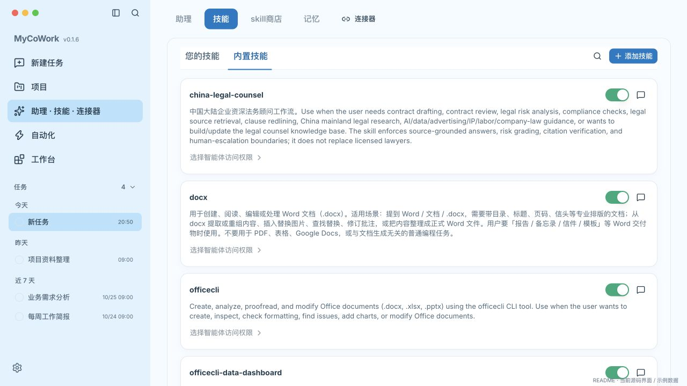

</details>

### Industry workbench

Use “Install ZIP” in the workbench (工作台) to add an app with its own business UI. The host validates package structure, version compatibility and file checksums. Installation or update waits for active work, saves a data recovery point and reloads the app.

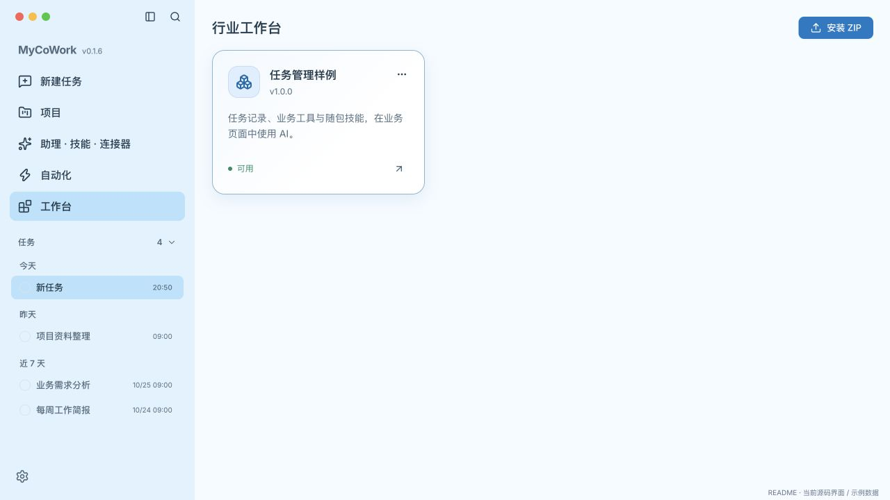

Apps can contribute business tools and skills. A controlled page bridge passes selected business content, starts AI tasks, exposes task records and files, and routes results back into the business page. The included taskboard example demonstrates entry points for risk analysis, weekly reports and subtask generation.

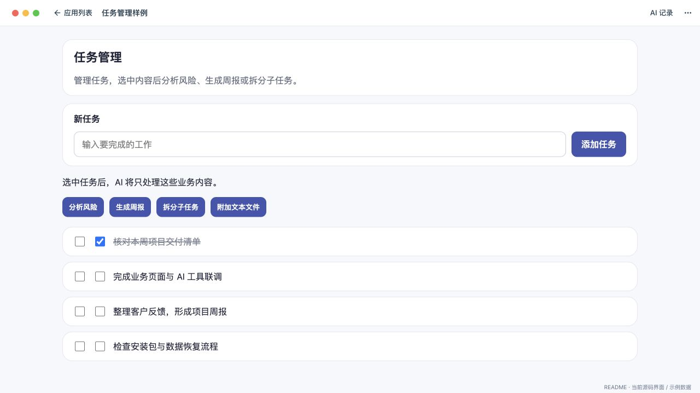

Current plugins contain a **Python backend and static web UI**. Python runs inside the host backend process. The installer neither creates a plugin virtual environment nor runs `pip` or `npm`. Page bridge restrictions do not isolate Python code, so install trusted apps.

Authoring references: [industry app development guide](docs/行业应用插件开发指南.md) · [taskboard example](examples/taskboard/README.md).

### Automations

The Automations (自动化) page configures instructions, schedule, workspace and allowed tools, and shows each run's status and result. It supports manual execution, pause, completion notifications and recovery review after interruption.

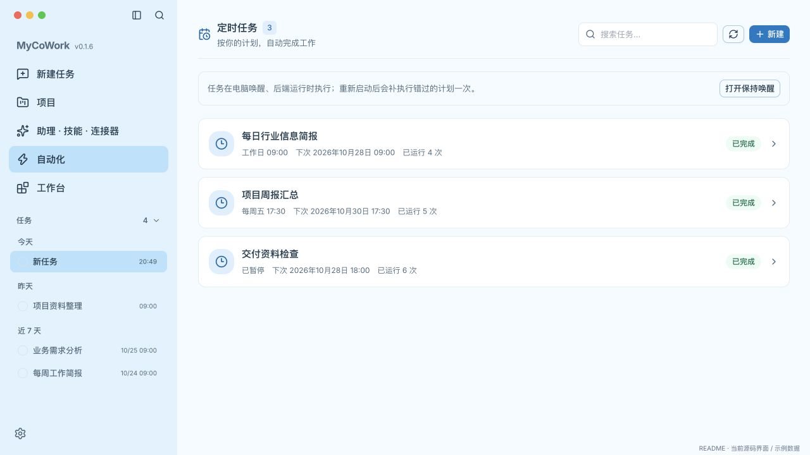

Schedules execute locally while the computer is awake and the backend is running. Restarting catches up a missed schedule once; recovery with uncertain side effects may require review. The app also offers a keep-awake setting.

### Models and remote channels

Open **Settings → Models** (设置 → 模型) to configure Anthropic, OpenAI, OpenRouter, DeepSeek, Qwen, Moonshot, MiniMax or a custom compatible service. Local services include Ollama, LM Studio and vLLM. Enter the endpoint, model ID and required credentials; configuration is saved after validation.

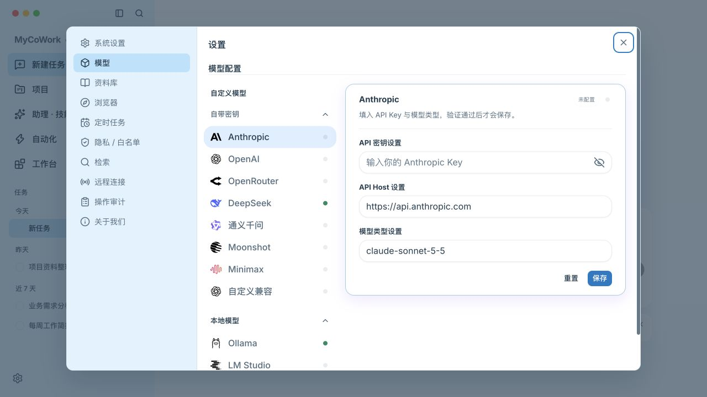

**Settings → Remote connections** (设置 → 远程连接) provides Feishu/Lark and WeChat. Feishu uses the official long connection; WeChat uses ClawBot QR sign-in. These paths do not require a public URL or Cloudflare Tunnel. Sleeping the computer or quitting the app interrupts availability.

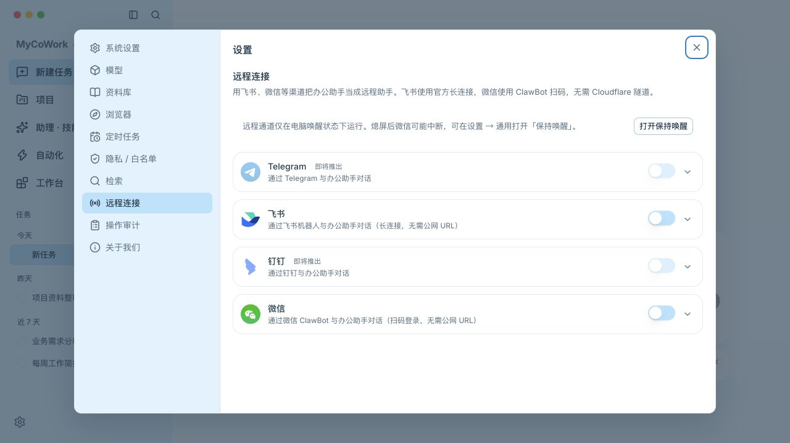

## Getting started

### Install and use

Download the appropriate installer from [GitHub Releases](https://github.com/xhthy00/my-cowork/releases): `.dmg` for macOS or NSIS `.exe` for Windows.

1. Configure a service in **Settings → Models**. Start the inference service first if using a local model.
2. Choose a workspace and model in “New task”, or start with an office assistant.
3. Describe the task, review requested operations, paths and commands, then inspect delivered files.

A simple file-delivery check:

> Create hello.md in the current workspace, write a short welcome message, and provide a file preview.

### Run from source

Recommended: **Node.js 22 LTS, Python 3.11 or 3.12, [uv](https://docs.astral.sh/uv/)**, and macOS or Windows. Run these commands from the repository root:

```bash
uv sync --project backend --locked --extra dev
npm ci

# Download office tools (use Git Bash on Windows)
npm run fetch:officecli

# Install Chromium before first using the built-in browser in source development
uv run --project backend python -m playwright install chromium

npm run dev
```

`npm run dev` starts Vite (default `127.0.0.1:5174`), compiles Electron and launches the desktop app. **Electron owns the Python backend and agent sidecar lifecycle**; normal development does not need a separate Uvicorn process. The OfficeCLI fetch script requires Bash; on Windows, install Git for Windows and use Git Bash. See the [deployment guide](docs/部署手册.md) for installation and use.

### Checks and packaging

```bash
# Backend tests and import boundaries
cd backend
uv run --locked --extra dev pytest -q
uv run --locked --extra dev lint-imports
cd ..

# Frontend / Electron unit tests; E2E includes a build
npm test
npm run test:e2e

# Preview build or release plans without pushing
npm run package:ci -- --dry-run
npm run release -- --dry-run
```

Cloud builds use [build.yml](.github/workflows/build.yml). On Windows, use `npm run package:win` or `npm run package:win:full` for a full rebuild. On macOS, run `npm run build:python:mac` followed by `bash scripts/build-electron.sh --mac`. Publishing requires a clean working tree and Git push access; `package:ci` also requires authenticated GitHub CLI. These commands push or publish; inspect the plan with `--dry-run` first.

Scaffold an industry app:

```bash
npm run app -- init /path/to/my-app --id cn.example.myapp --name MyBusinessApp
npm --prefix /path/to/my-app/frontend install
npm run app -- dev /path/to/my-app
npm run app -- pack /path/to/my-app -o /path/to/my-app.zip
```

`dev` uses isolated development data and a separate credential scope. Install the packaged app through the workbench's “Install ZIP”.

## Architecture and data boundaries

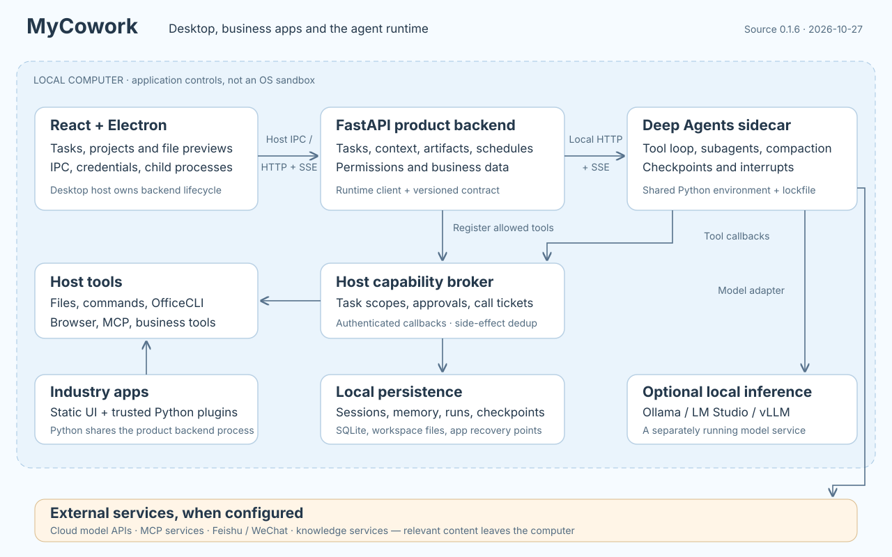

The Electron main process manages desktop capabilities, credentials and child processes. React accesses local FastAPI through the host. The product backend owns tasks, permissions, business data and tools. A separate `cowork_harness` sidecar runs official Deep Agents and calls host capabilities for files, commands, browsing, MCP and industry tools.

| Module | Responsibility |
| --- | --- |
| `renderer/`, `electron/` | UI, previews, IPC, credentials and process lifecycle |
| `backend/app/orchestrator/` | Product tasks, entry-point context, events and artifacts |
| `backend/cowork_harness/` | Deep Agents factory, subagents, checkpoints, persistent interrupts, events and budgets |
| `backend/runtime_contract/`, `app/runtime_client/` | Versioned protocol, sidecar startup and build compatibility checks |
| `backend/app/host_capabilities/` | Tool callbacks, task scopes, approval tickets and side-effect deduplication |
| `backend/model_integrations/` | Shared host and harness model adapters |
| `backend/app/industry_apps/`, `automation/`, `server/channels/` | Industry apps, scheduled runs and remote channels |

Backend and sidecar share one Python environment, `backend/pyproject.toml` and `backend/uv.lock`. Deep Agents is currently pinned to 0.7.23. Its graph manages tool loops, subagents and context compaction, while the product retains authorization and delivery. See the [Deep Agents implementation notes](docs/DeepAgents实施说明.md).

- **Local data:** sessions, memory, schedules and run records persist locally. Delivered files go to the task's working directory; actual paths depend on workspace and settings.
- **Models and external tools:** cloud models, MCP, channels and knowledge services may send relevant content to external endpoints. Local models require a separately deployed inference service.
- **Credentials:** desktop storage uses Electron `safeStorage` encryption when available. If unavailable and no encrypted file exists, the current implementation can fall back to a local JSON file protected by file permissions. Credentials are not guaranteed to reside exclusively in the OS keychain.
- **Permissions:** file allowlists, workspace restrictions, command policies and approvals constrain host tools. The backend's default path scope includes the home directory and can be narrowed under “Privacy / Allowlist”. These are application controls, not an OS sandbox.
- **Availability:** automations, channels and industry tasks depend on the local application and backend. They are not a separate always-on cloud service.

## Repository and documentation

```text
backend/                   Product backend, harness, shared protocol and tests
electron/                  Desktop main process and preload bridge
renderer/                  React UI and styles
packages/app-sdk/          Industry app frontend SDK
templates/industry-app/    Industry app scaffold
examples/taskboard/        Runnable industry app example
skills/                    Repository skills
resources/example-skills/ Bundled and third-party skills
scripts/, build/           Development, dependencies, packaging and releases
docs/                      Implementation, development, deployment and screenshots
```

- [Development guide](docs/开发指南.md): local development, skills, MCP and assistants.
- [Deployment guide](docs/部署手册.md): installation, dependencies, configuration and packaging. For remote channels, follow this README and the current settings UI.
- [Deep Agents implementation](docs/DeepAgents实施说明.md): runtime, contracts, permissions and validation.
- [Industry app development](docs/行业应用插件开发指南.md): packaging, SDK, tools, business AI and lifecycle.
- [Skills](skills/README.md) · [Screenshot maintenance](docs/screenshots/README.md).

## License

This repository uses the [MIT License](LICENSE). Bundled third-party skills under `resources/example-skills/` retain the original licenses in their respective directories.
