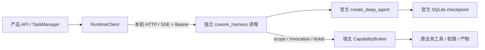

# Deep Agents 实施说明

当前代码已切换到 Python Deep Agents，统一锁定 `deepagents==0.7.23`。单代理、Workforce、定时任务、远程渠道和行业应用都通过同一个 TaskManager → RuntimeClient → harness 路径执行。自研图、Act loop、协调器、依赖调度、压缩、结果合成循环和额外 planner 模型调用已删除；评测用 critic 移到 `backend/eval/quality.py`，不参与生产执行。

## 独立边界和共享环境



宿主和 harness 使用同一个 `sys.executable`，开发时均为 `backend/.venv`；冻结后由同一个打包可执行文件的 `--role=harness` 入口启动，使用 [PyInstaller 的独立实例初始化](https://pyinstaller.org/en/stable/common-issues-and-pitfalls.html) 以免依赖父进程临时文件生命周期。只有 `backend/pyproject.toml` 和 `backend/uv.lock`，没有 harness 专属环境或锁。协议、Deep Agents 版本和锁文件 SHA-256 不一致会阻止 readiness。

`cowork_harness` 不导入 `app`；产品编排、路由、自动化和工具代理不导入 harness 实现。仅组合入口 `app/main.py` 负责冻结角色分发和测试模型注入。业务工具仍以现有 BaseTool 包装留在宿主，由 JSON 描述和 RPC 暴露，避免一次重写所有业务函数；统一依赖升级会同时验证这部分。

模型配置与密钥由后端提供，密钥继承在进程环境中，不写入 RunRequest、checkpoint 或工具 schema。`model_integrations` 为模型设置验证与 harness 提供一份共享实现。

原生 DeepSeek 使用官方 `langchain-deepseek`（统一锁内为 1.1.1）解析流式和非流式推理字段；首次强制 `write_todos` 的调用显式传入 `thinking.type=disabled`，后续恢复原思考配置。其他同格式原生接口复用其公开解析器，历史回传按 endpoint 单独处理。OpenRouter 使用官方 `langchain-openrouter`，Anthropic 使用 `langchain-anthropic` 保留签名。兼容层由真实 SDK 的模拟 HTTP 格式回归覆盖，不修改 SDK 私有方法。各厂商能力、规划策略和验证边界见[模型兼容性检查](模型兼容性检查.md)。

## 保留的产品行为

- `/api/chat`、`/api/workforce/start`、确认和用户答复入口继续使用；计划工具通过官方 interrupt 返回用户编辑后的子任务。远程渠道按既有策略直接采用计划，避免等待仅存在于桌面端的计划确认。
- 工具副作用先在宿主申请随机票据，批准后才能执行。scope、调用 ID、工具及参数同时校验。完成结果可重放；中断或异常后状态未知的调用禁止自动重放。
- 会话、事件序号、待批调用和用户提问持久化。断开 SSE 不取消后台运行；普通任务等待输入时重启宿主可恢复。行业应用的函数回调不可跨重启序列化，旧任务明确标为 INTERRUPTED，重新发起任务。
- 官方文件工具读取虚拟工作区、技能和记忆；内置写入、删除和命令工具被公开 profile 排除。真实写入、Office、命令、浏览器、MCP 和行业工具走宿主权限。
- 技能按角色与用户选择生成稳定资源快照，并规范化 legacy skill.yaml；应用技能保持独立身份。官方 SkillsMiddleware 负责渐进加载，MemoryMiddleware 读取宿主选择的记忆快照，更新仍通过业务记忆工具。
- 子代理按角色限制宿主工具，统一统计模型调用次数和 token 用量。任务默认没有产品层的累计调用次数或 token 上限，不再因调用 50 次或累计超过 20 万 tokens 而停止；仅显式设置 `MY_COWORK_MAX_STEPS` / `MY_COWORK_MAX_TOKENS` 为正整数时启用对应限制。底层图沿用上游默认递归保护，不再根据默认 50 次生成更小的递归上限。模型上下文窗口独立于累计用量。工具事件关联实际委派实例，命令取消会停止进程树。
- 同步宿主工具可以在 LangChain 工作线程中执行，但 TraceBus 会把记忆通知等事件送回后端事件循环，再由任务和追踪存储落库，避免跨线程使用 SQLite 连接。
- 新任务的首次模型调用由公开 ModelRequest middleware 限定到官方 `write_todos`，步骤发布后恢复完整工具集合；追问清空上一轮 todos，审批恢复保留本轮 todos。指定工具、required 或 auto 按接口能力选择；仅指定工具且支持关闭思考的模型使用规划副本处理冲突。auto/required 未返回有效规划时由官方图 hook 有限重试，不强制关闭思考专用模型，也不向自定义端点猜测厂商参数。
- 正文流仅发布已有规划的根代理 `model` 节点回答，不把规划前正文或上下文压缩 middleware 的内部摘要显示为用户答复。
- 官方中断负责计划编辑、提问和审批；没有第二套 planner、DAG 或失败重试循环。发布步骤不需要用户确认；复杂 Workforce 任务仍通过计划工具请求确认。

## 数据与故障恢复

新增数据位于 `MY_COWORK_DATA_DIR` 下：

| 路径 | 内容 |
| --- | --- |
| `harness/runs.db` | 运行、事件、中断及 session epoch |
| `harness/checkpoints.db` | 官方 LangGraph 状态 |
| `tool-invocations.db` | 宿主权限快照、审批票据及副作用执行记录 |
| `harness-skills/`、`harness-memory/` | 本次任务读取的资源快照 |
| `harness/upgrade-backups/` | 切换共享构建前的 runtime SQLite 一致备份 |

旧 `sessions.db` 的用户与最终助手消息在新会话首次运行时导入。旧自研图的 checkpoint、内部压缩状态和未完成模型循环不导入新图。

启动时遇到正在运行或 queued 的旧运行，标为 interrupted 并生成失败终态；不会重发模型或未知工具调用。waiting_user 保持官方 checkpoint，通过原 interrupt ID 恢复。取消时清除该运行的 session epoch，后续新任务不会误恢复被取消的中断。

共享依赖构建标识改变前，runtime 自动备份自己的数据库。协议版本不兼容会拒绝启动。这些备份不等于完整应用安装包自动回退：当前 Electron updater 仍需补齐整包和产品数据的自动恢复机制。未知副作用不能通过恢复旧数据库来抹除，必须对账后重新发起任务。

## 自动维护流水线

`deepagents-upgrade.yml` 每周一 02:00 UTC 检查 PyPI 上兼容 Python 3.11 的非预发布、非 yanked 版本：

1. 用当前统一环境持久化待答复中断和已完成的模拟副作用。
2. 更新 Deep Agents 精确版本，求解、安装整个后端锁。
3. 用候选版本恢复旧 checkpoint，验证答复继续且副作用不重放。
4. 运行完整后端测试与真实 sidecar 启动验证。
5. 更新完整项目 patch 版本，创建或更新依赖 PR。
6. 所有后端、前端、macOS/Windows 冻結与打包检查通过后，允许机器人自动合并。
7. 合并后自动触发指定提交的完整项目发布；客户端自动下载，退出时安装。主动安装前暂停新任务并检查在途任务。

任一步失败都阻止候选合并或发布，保留当前 stable。上游删除公开 API、checkpoint 不兼容和共享依赖冲突可能需要例外适配；日常升级由流水线完成。

### 首次启用（只做一次）

当前仅修改本地代码，没有修改 GitHub 设置、发布安装包或创建远程 PR。

- 为自动更新机器人配置 `DEPENDENCY_UPDATE_TOKEN`，允许创建 PR、触发 Actions 和合并。仅使用默认 GITHUB_TOKEN 创建的 PR 可能不能触发后续检查。
- 默认分支启用保护，必须通过 `quality`、`python-macos`、`python-windows`、`electron`、`electron-windows`。当前自动合并步骤会检查 classic branch protection；使用 rulesets 的仓库需要对应调整该校验。
- 仓库变量 `DEEPAGENTS_AUTO_MERGE=true`、`DEEPAGENTS_AUTO_RELEASE=true` 启用自动合并与完整发布；未配置时仍会提出已验证的候选 PR，但不自动合并/发布。
- 在 `production-release` 环境配置 `MAC_CSC_LINK`、`MAC_CSC_KEY_PASSWORD`、`MAC_CSC_NAME`、`APPLE_ID`、`APPLE_APP_SPECIFIC_PASSWORD`、`APPLE_TEAM_ID`、`WIN_CSC_LINK`、`WIN_CSC_KEY_PASSWORD`。自动发布阶段强制签名并启用 macOS 公证，覆盖原构建文件的 unsigned 配置；PR 验证不读取发布凭据。缺少凭据时自动发布失败，不会把未签名候选推送 stable。此分发路径仍需用真实凭据和各平台安装包验收。
- 在 Windows 真机/CI、macOS 全新安装环境执行冻结、安装和更新验收，并完成真实模型质量/成本评测及整包回退演练。没有凭据和平台验收时，不应将生产无人值守交付标为完成。

## 本地验证

```bash
cd backend
uv sync --locked --extra dev
uv run --locked pytest -q
cd ..
npm test
npm run build
backend/.venv/bin/python scripts/smoke-harness.py
backend/.venv/bin/python scripts/check-harness-upgrade.py prepare --data-dir /tmp/cowork-upgrade-fixture
backend/.venv/bin/python scripts/check-harness-upgrade.py verify --data-dir /tmp/cowork-upgrade-fixture
```

冻结检查：

```bash
backend/.venv/bin/python -m PyInstaller build/pyinstaller/macos.spec --distpath /tmp/cowork-frozen/dist --workpath /tmp/cowork-frozen/work -y
backend/.venv/bin/python scripts/smoke-harness.py --binary /tmp/cowork-frozen/dist/my-cowork-backend
backend/.venv/bin/python scripts/smoke-backend.py --binary /tmp/cowork-frozen/dist/my-cowork-backend
```

`prepare` 必须在依赖升级前运行，`verify` 在升级后运行；正常本地同版本执行验证的是进程重建，CI 才会验证基线→候选的真实库版本切换。测试中的模型和外部副作用是确定性的模拟，没有实际发送消息或调用付费模型。

## 本次验证记录（2026-10-14）

- 完整后端：713 项通过，包括官方执行、模型协议、审批/提问/计划恢复、失败后新会话、并发、权限、业务工具和依赖边界。
- 前端：462 项通过；TypeScript 和 Vite 生产构建通过。
- macOS arm64 PyInstaller 构建通过；最终冻结产物通过私有鉴权/共享锁摘要/SQLite saver 及后端→同可执行文件 harness 联合启动。
- 升级 fixture 的 prepare/verify 两阶段通过：已完成工具结果和待答复中断持久化，恢复不重复产生副作用。本地验证为同库版本重建，真实跨上游版本由候选流水线验证。
- 工作流 YAML 和 git diff 空白检查通过。
- 本地没有执行 Windows 安装、公证发布、真实付费模型评测、两次真实上游自动发布或整包自动回退；上述项目不能算已验证。

## 调用次数默认限额修复（2026-10-15）

扬州政策调研任务的运行记录显示 `max_steps=50`、`max_total_tokens=null`；失败前累计 50 次模型调用、4,329,816 tokens，错误为 `Agent budget exhausted`。这与此前的 503 服务繁忙是不同原因；UI 的四项规划步骤也不等于模型调用次数。

新任务的 `RunRequest.max_steps`、TaskManager 默认值改为 null。所有代理和内部模型调用继续统计次数，但只有显式设置正整数 `MY_COWORK_MAX_STEPS` 或直接传入 max_steps 时才拦截；错误明确显示配置的调用次数上限。未设置时不覆盖上游图的默认递归保护。已结束的失败任务不自动重跑，也不修改旧的请求记录。

专项回归验证单代理连续 57 次调用、多代理合计 59 次调用仍能交付；同时验证宿主默认空值透传、显式环境限额和主子代理共享显式限额。修改开发代码后需要完整重启应用及后端，已有失败任务可在新版本下重新发起。

## 上下文窗口显示修复（2026-10-15）

输入框的上下文指示器从当前 SDK 模型 profile 读取 `max_input_tokens`，与官方摘要阈值使用同一信息来源。删除后端 `MY_COWORK_CONTEXT_LIMIT=200000` 的显示默认值，以及前端固定 200k 分母。当前锁内原生 deepseek-flash 的 profile 为 1,000,000，显示为 1.0M；profile 未知时显示“上下文窗口未知”，不显示虚构百分比。

`/api/model/info` 仅创建本地 SDK 配置并读取元数据，不读取用户密钥，也不调用厂商模型。选择器在切换配置后重新读取容量；配置来源由 provider、model、endpoint 的摘要关联，防止同名型号在不同端点间沿用旧数据。运行中的备用模型通过自身 SDK metadata 上报容量，仍关联原始选择配置。

`budget.update` 中的累计 tokens 包含所有代理，但 `context_tokens/context_limit` 仅由主代理的实际模型调用更新，摘要及子代理不覆盖会话指示器。输入占用优先采用厂商返回的 input_tokens；缺失时使用公开近似计数。前端不再用完整聊天原文取最大值，因此压缩后上下文占用可以下降。显示修改不改变压缩策略或新增预算上限。

验证包括真实 SDK JSON/SSE 上报、备用模型切换、主子代理区分、无模型调用的元数据接口、未知窗口、切换模型和压缩后计数下降；完整后端 728 项、前端 470 项通过，TypeScript/Vite 构建通过。

## MiniMax 上下文窗口适配（2026-10-15）

当前 SDK 尚未收录 MiniMax 型号的 profile。按 [MiniMax 官方型号表](https://platform.minimax.io/docs/api-reference/text-openai-api)补齐官方端点 `api.minimaxi.com`、`api.minimax.io` 的已知型号：M3、M3.1-Flash-Preview 为 1,000,000 tokens；M2、M2.1、M2.5、M2.7 及列出的 highspeed 版本为 204,800 tokens。OpenAI、Anthropic 兼容入口共用此适配。

容量写入模型公开的 `profile.max_input_tokens`，随后由元数据接口和运行时上报读取；官方 Deep Agents 因此按窗口 85% 触发摘要、保留 10%，界面和压缩使用同一容量。该值是上下文窗口，不是累计任务 token 预算。若 SDK 后续提供有效容量，优先使用 SDK 数据；未知新型号、自定义代理和本地端点不按名字猜测容量。

验证：完整后端 766 项通过；前端窗口显示、格式化及设置回归 29 项通过；4 项依赖边界契约通过。测试使用本地元数据和模拟 HTTP 响应，没有调用付费模型。

## 澄清追问恢复表单卡片（2026-10-15）

`ask_human.fields` 改为宿主与独立 harness 共同使用的 `HumanQuestionField`，模型可以看到 label、kind（single/multiple/text）、options、required、placeholder 的完整结构，不再只看到无字段说明的任意字典。主代理和子代理共享澄清规则：确有执行所需的信息缺口时调用 `ask_human`，合并必要问题，以卡片等待答复；不把纯文字追问当作已完成任务。可以通过工具查明的信息及常规选择不应额外询问。

复用现有 HumanQuestionCard、`human.ask` 事件和 `/api/chat/{task_id}/human-reply`，提交表单后恢复同一任务及 checkpoint。已有的普通文字追问不会被猜测解析为新中断；后续运行使用新规则。回归覆盖单/多代理、子代理、挂起任务重启恢复、字段 schema、HTTP 回复原任务，以及前端从事件显示表单至提交继续的完整交互。

验证：完整后端 771 项通过；前端表单相关 21 项通过；4 项依赖边界契约通过。使用脚本模型与本地测试通路，没有调用付费模型。完整重启应用及后端后新运行采用这些配置。

### MiniMax 首轮澄清被规划门禁拦截的修复

11:01 的实际失败记录显示模型首先调用了 `ask_human`，但规划门禁只允许 `write_todos`，该提问被当作未规划的工具调用拒绝。模型随后发布规划，却把未执行的提问误认为已展示，最终输出纯文字选项并结束任务。此前只验证“先规划、后提问”的脚本序列，遗漏了实际发生的先提问路径。

对采用 auto/required 工具选择的端点，初始阶段同时暴露 `write_todos` 和 `ask_human`，允许必要澄清先于规划执行；其他业务操作仍须先发布规划。使用强制指定规划工具的端点保留原策略。提问 schema 兼容这次返回的 `fields.item`、`options.item` 包装、question 字段别名、选项 label 对象与字符串布尔值，统一转换成现有表单合同。通过模型公开消息、Pydantic 校验器及官方中断实现，未增加自研执行循环或正文猜测解析。

新增回归将本次原始参数通过真实 MiniMax SDK 的 JSON/SSE 响应解析送入官方图，验证第一次调用即产生 `human.ask`、进入 waiting_user 而不发送 graph.end；提交后回到原 checkpoint 发布规划并继续执行。该回放没有调用付费模型。

修复后完整后端 773 项、前端表单相关 21 项通过，4 项依赖边界契约通过。已结束的旧任务未被自动重跑，运行中的 Python 进程需重启以加载新实现。

## HTML 代码被末尾短答复覆盖及未实际落盘（2026-10-15）

FED 任务的记录显示：模型在携带 write_todos 调用的 AI 消息里输出完整 HTML，未调用任何文件写入工具；最后一条无工具调用的 AI 消息仅声称可自行保存。harness 只把最后一条消息作为 graph.end.summary，前端据此替换流式内容，完整 HTML 因而从可见答复中丢失。工作目录不存在该文件，所以也无法登记产出物卡片。该次 HTML 已从 checkpoint 原文找回，未重新生成内容或自动重跑付费任务。

新增公开 middleware：对用户或表单答复明确要求的 HTML 报告，在完整代码已生成但尚未尝试保存时，通过官方 jump_to=model 最多提醒两次调用宿主 fs_write。写入依旧走现有审批、路径校验与文件登记，拒绝后不重复申请。规划阶段之后明确恢复工具列表，防止模型继续沿用初始阶段的能力判断。

最终答复同时检查本轮 AI 消息中的完整 HTML：仅在没有成功写入证据且最后短答复遗漏代码时保留完整代码并标注未确认保存。不会凭文件名伪造卡片，不从旧轮次、未闭合 HTML 或思考内容恢复文档。回归包含“表单指定 HTML → 生成代码并更新步骤 → 短答复 → 受审批的真实保存 → artifact.file”，以及拒绝保存、有限重试和仅解释代码的任务。

验证：完整后端 778 项、前端产出物与会话相关 56 项通过，4 项依赖边界契约通过；未运行付费模型。运行中的后端和 harness 需重启以加载新逻辑。
