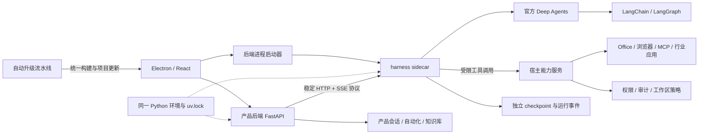

# Deep Agents Python 独立运行时替换方案

实施代码、已验证范围与生产启用条件见 [DeepAgents 实施说明](DeepAgents实施说明.md)。本文件保留原始目标和验收要求，未完成的生产发布与整包回退验收不会标记为已完成。

初版：2026-10-10。修订：2026-10-13。状态：执行设计，尚未实施运行时代码替换。

目标：彻底删除 my-cowork 自研 Agent 执行循环，由官方 `deepagents` Python 包负责 harness；harness 保持独立代码模块和接口，与项目后端共享 Python 解释器、依赖环境和锁文件，日常更新由流水线和项目更新机制自动完成。

推荐决策：采用 **独立 harness 模块 + 共享后端 Python 环境 + 稳定运行时协议 + 自动升级流水线**。保留原方案的 sidecar 进程边界，两个进程使用同一解释器和依赖集合；不再为 harness 创建专属 uv 项目、虚拟环境或带解释器的发布包。

## 1. 已核实的现状与参考边界

### 1.1 my-cowork 不是只需要替换一个函数

实际调用链为：

```text
/api/chat / 自动化 / 行业应用 / 渠道
  → TaskManager.handle
  → runtime/graph_runner.run_graph
  → single_agent / workforce 图
  → runtime/v2 的执行循环、压缩、校验、汇总
  → 模型、工具、工作区与权限服务
```

核查依据：

| 位置 | 现有职责 | 对替换的影响 |
| --- | --- | --- |
| `backend/app/main.py` | 组装模型、工具、两种图、checkpoint 和 TaskManager | 必须改为组装 runtime client，移除图和 Agent 模型初始化 |
| `backend/app/orchestrator/task_manager.py` | 生命周期、取消、排队、流式转发，同时直接依赖 graph runner | 保留产品生命周期；移除 graph、planner、LangChain 工具对象依赖 |
| `backend/app/runtime/graph_runner.py` | 拆解、计划确认、上下文、图运行、预算、产物、结果清理 | 逐项迁移，最终删除执行部分 |
| `backend/app/graphs/workforce.py` | Coordinator、依赖路由、worker、重试、汇总，并调用 v2 能力 | 删除自研编排；改用官方 subagents |
| `backend/app/runtime/v2/loop.py` | 自己 bind_tools、调用模型、执行工具、决定停止 | 必须删除，不能包在 Deep Agents 外继续使用 |
| `backend/app/runtime/v2/compact.py`、`runtime/compressor.py` | 自研上下文压缩 | 由上游 summarization/offloading 接管 |
| `backend/app/runtime/v2/session.py` | 会话消息、压缩状态，默认 `sessions.db` | 迁移历史；旧图状态不能直接转成新 checkpoint |
| `backend/app/guardrails/approval.py`、`runtime/app_context.py` | 授权、自动化权限、行业应用能力范围，依赖 ContextVar | 跨进程后必须显式传递和恢复可信执行上下文 |
| `electron/python_runner.ts`、`build/pyinstaller/*.spec` | Electron 启动一个 Python 后端，打包时冻结依赖 | 增加同一后端环境中的 harness 入口，统一构建与更新 |
| `backend/.importlinter`、`backend/tests/test_layering.py` | 九层 harness 依赖约束 | 改成宿主／协议／runtime 隔离约束 |

现有图和 v2 循环存在交叉调用，不能当成互不相关的两个替换点。

### 1.2 本地 DeepCode 的事实

用户给定目录：`/Users/tanghaoyu/develop/git-repo/agent/DeepCode`。

初版于 2026-10-10 检查的提交是 `84c37f79`，提交说明为 `release: prepare DeepCode v2.3.0`，当时分支为 `main`。在当时检索的工作树及依赖清单中，未发现 `deepagents`、`create_deep_agent` 或 LangChain Agent 接入；`requirements.txt` 明确使用 DeepCode-native LLM + MCP runtime。此次修订仅调整共享环境设计，未重新检查该参考仓库。

因此不能将这个版本说成 Deep Agents 的使用示例。可参考的是它真实存在的工程边界：

| DeepCode 文件 | 可借鉴内容 | 本方案如何使用 |
| --- | --- | --- |
| `app_server/protocol/methods.py` | thread、turn、审批、事件回放等协议化入口 | 区分会话、运行、审批、回放，独立于执行内核 |
| `app_server/host.py` | 应用所有权与传输层分离 | 产品宿主保持所有权，runtime 提供执行服务 |
| `app_server/runtime_install.py` | 完整 onedir 包、版本和摘要、临时目录安装、锁、原子发布 | 借鉴完整发布包校验与回退；不复制独立 harness 环境 |
| `core/harness/__init__.py` | 权限机制与模型/UI 分离 | 宿主权限服务不参与模型循环 |

不复制 `core/agent_runtime/runner.py`、压缩器、repeat guard 等自研执行逻辑。若另有 Deep Agents 示例分支或文件，在第一阶段替换参考依据；不据此推迟其他设计工作。

## 2. 对“免去维护升级”的具体承诺

交付时应达到：

1. 官方实现直接来自 PyPI `deepagents`，不 fork、不 vendoring、不修改安装目录、不依赖私有成员。
2. Deep Agents、LangGraph、LangChain 及模型适配依赖统一声明在 `backend/pyproject.toml`，由 `backend/uv.lock` 锁定；runtime 使用后端同一个环境。
3. 官方更新被流水线自动发现、求解、测试、构建、签名、灰度和发布。
4. 客户端通过项目更新机制接收已验证发布包；正常更新不要求用户手工运行 pip、uv 或修改代码。当前冻结依赖随桌面安装包分发，因此上游升级会触发后端构建及项目自动发布。
5. 不兼容或回归版本自动停止推广，客户端保持最后可用版本；只有流水线无法处理的变化才通知维护者。

**可实现的是日常升级零手工操作，不能保证任何未来破坏性 API 或持久化格式变化永远不需要适配。** 接口差异集中在 harness adapter；共享环境意味着依赖冲突也必须在后端整体检查中处理，不能承诺上游更新完全不影响后端依赖。

自动更新对象是“本项目验证的完整发布版本”，不能在运行中的共享环境直接执行 pip upgrade。代码独立、接口独立保留；环境、锁文件、构建和更新统一。

## 3. 目标结构



三个所有权边界：

| 所有者 | 负责 | 不承担 |
| --- | --- | --- |
| 产品宿主 | HTTP/UI、会话目录、排队、自动化触发、渠道、行业应用、能力授权、产物展示 | Agent 推理循环、消息裁剪、分工与重试编排 |
| 独立 harness 模块／进程 | 官方 Agent 工厂、stream/interrupt 接入、模型配置、checkpoint 生命周期、协议转换 | 用户产品数据库和 UI 状态 |
| 官方 Deep Agents | Agent 循环、上下文管理、内置文件工具、subagent 执行 | Electron 更新、业务审批策略、Office 工具、产品知识库 |

Deep Agents 的内置能力和公开扩展接口以官方 [overview](https://docs.langchain.com/oss/python/deepagents/overview)、[customization](https://docs.langchain.com/oss/python/deepagents/customization) 为依据。保留宿主业务能力不会形成第二套 Agent 执行器。

### 3.1 目录与依赖

以下是计划新增路径，当前尚不存在：

```text
packages/runtime-contract/
  schemas/                       JSON Schema：纯 JSON 协议
  generated/python/              宿主与 runtime 使用的生成类型
  generated/typescript/          桌面端使用的生成类型

backend/
  pyproject.toml                 后端与 harness 的统一依赖声明
  uv.lock                        唯一依赖锁文件
  .venv/                         开发时共享的 Python 环境
  cowork_harness/                与 app 平级的独立代码包
    server.py                    本地服务与生命周期
    agent_factory.py             唯一 Deep Agents 组装入口
    upstream_adapter.py          公开 API 的集中适配点
    events.py                    官方流 → 稳定事件
    persistence.py               官方 saver 的启动／关闭
    host_tools.py                JSON 工具声明 → 官方工具对象
    policy.py                    宿主策略 → 官方配置／薄 middleware
  tests/harness/contract/
  tests/harness/upgrade/

backend/app/runtime_client/
  client.py                      只依赖 HTTP 和协议类型
  events.py                      稳定事件 → 现有 UI 事件
backend/app/host_capabilities/
  tools.py                       业务工具声明与执行
  execution.py                   命令授权、取消、审计

electron/python_runner.ts        同一环境启动宿主与 harness 两个入口
build/pyinstaller/*.spec         统一后端产物，包含两个执行入口
.github/workflows/deepagents-upgrade.yml
.github/workflows/build.yml      复用项目构建与发布
```

宿主业务模块通过 runtime client 调用 harness，不直接导入 `cowork_harness` 的内部实现、`deepagents` 或 Agent 执行用的 LangChain/LangGraph；harness 不可 `import app.*`。上述限制是代码依赖方向约束，不是环境隔离。协议包不依赖双方实现，不含 Callable、BaseTool、BaseChatModel、数据库连接等进程对象。

宿主现有工具中的 `@tool`／`BaseTool` 必须逐步抽成普通 Python 业务函数，工具包装移到 harness。知识库可以在共享环境使用检索／embedding SDK，但不复用 harness 的 Agent 模型对象。将 `cowork_harness` 加入现有 setuptools 包清单；仅在 backend 执行一次 `uv sync --locked`，即可安装双方所需依赖。

### 3.2 启动与退出顺序

Electron 是两个进程的唯一生命周期所有者：先启动产品宿主，使数据库和能力接口就绪；再使用同一版本后端环境启动 sidecar、提供宿主工具地址并完成握手；最后给宿主 runtime client 配置已验证的连接。宿主基础 `/health` 与 Agent readiness 分开，避免宿主等待 runtime、runtime 又等待宿主的启动死锁。

开发时两个入口分别为 `backend/.venv/bin/python -m app.main` 和同一解释器的 `-m cowork_harness.server`（Windows 使用 `.venv/Scripts/python.exe`）。打包时使用同一冻结后端程序的角色入口，例如 `--role=host` 与 `--role=harness`，具体参数在实施时加入统一入口；双方使用相同的包版本，不存在独立 harness 解释器。

runtime 退出时宿主关闭新运行入口并显示可恢复状态，Electron 先尝试同版本重启；升级回退以整个后端／项目发布版本为单位。宿主退出时 runtime 停止接受执行并冻结无法继续调用的业务工具。应用退出先停止 admission，再排空／中断运行，最后关闭 runtime 和宿主。两个进程及其命令子进程都纳入父进程死亡与进程树清理，不能只 kill 原有 Python backend。

## 4. 替换与保留清单

| 现有能力／文件 | 目标实现 | 最终处理 |
| --- | --- | --- |
| `graphs/single_agent.py`、`graphs/workforce.py`、`graphs/coordinator.py`、`graphs/routing.py` | 官方 Deep Agents 主代理和声明式 subagents | 删除自研图和状态路由 |
| `runtime/v2/loop.py`、`runtime/agent_stream.py` 的执行逻辑 | 官方运行与流式接口 | 删除自研模型／工具循环 |
| `runtime/decompose.py`、`runtime/todo_planner.py` | 官方 TodoListMiddleware；可选计划确认工具 | 删除额外 planner 模型循环 |
| `runtime/compressor.py`、`runtime/v2/compact.py` | 官方 summarization 与工具结果 offloading | 删除自研压缩策略 |
| `runtime/v2/critic.py`、`synthesize.py` 中通用纠错／汇总 | 主代理或官方子代理 | 删除自研 critic/rework/finalization 循环 |
| 文档完整性、文件存在、产物类型检查 | 文档业务工具的确定性结果校验 | 保留为业务校验，不触发第二套智能体循环 |
| `runtime/checkpointer.py` | runtime 内官方 AsyncSqliteSaver | 重写资源生命周期；宿主不读内部图状态 |
| `llm/gateway.py`、Agent fallback/token callback | runtime 官方模型适配、公开 middleware/callback | 迁移必要 provider 配置；不重造模型协议 |
| `tools/builtin/fs.py` | 官方文件工具 + 公开 filesystem backend | 替换；产物登记留在宿主 |
| `tools/builtin/exec.py`、`sandbox/`、`guardrails/command_filter.py` | 宿主命令能力和现有策略 | 抽离执行函数；保留授权／进程管理机制 |
| `tools/builtin/human.py`、`guardrails/human_input.py` | 官方 interrupt/resume + 产品问题记录 | 删除阻塞 Agent 的内存 Future 机制 |
| `tools/builtin/skills.py` 的提示词加载 | 官方 skills 渐进加载 | 替换；技能市场、安装与开关留在宿主 |
| `memory/short_term.py` | 官方会话 checkpoint + 产品 transcript | 删除重复的模型上下文所有权 |
| `memory/long_term.py`、`memory/scoped.py` | 宿主范围化检索工具；偏好文件使用官方 memory | 保留知识检索；不把向量检索误认为 AGENTS.md 记忆 |
| `orchestrator/task_manager.py` | runtime client + 产品任务生命周期 | 精简，移除 graph/planner/tools/long_term 参数 |
| `automation/`、`industry_apps/`、channels | 调同一 runtime 协议 | 保留产品功能，统一执行入口 |
| `observability/` | 稳定事件、审计、模型用量与成本 | 保留产品日志；模型回调移到 runtime |

“完全替换”验收条件是产品只存在一个 Agent 执行入口，由官方 Deep Agents 执行。把旧循环换目录、包在 middleware 内、改名为 backend 都不算完成。

## 5. 稳定运行时协议

默认使用跨平台一致的 `127.0.0.1` 随机端口 HTTP + SSE；每次启动生成控制 token，通过继承的匿名管道传递，不放在 URL、日志或模型上下文。宿主到 runtime 和 runtime 到宿主使用不同凭据。显式限制来源与 Host；浏览器不能直接调用内部工具接口。

协议版本与 runtime 版本分开：`protocol_version=1` 对应稳定 JSON 合约；Deep Agents 版本只作为诊断元数据，不影响 UI 协议。

| 方法 | 用途 | 必须保证 |
| --- | --- | --- |
| `GET /v1/health` | 健康与协议／能力协商 | readiness、版本、持久化可用、支持的能力 |
| `POST /v1/runs` | 提交运行 | `request_id` 去重，返回 run_id；提交与 SSE 连接分离 |
| `GET /v1/runs/{id}/events?after={seq}` | 流与重放 | 持久事件、序号、断线恢复；断流不重启执行 |
| `GET /v1/runs/{id}` | 状态与挂起中断 | 可以在 UI 重启后恢复审批界面 |
| `POST /v1/runs/{id}/resume` | 审批、用户答复、计划确认 | interrupt_id、版本检查、幂等；不得恢复错轮次 |
| `POST /v1/runs/{id}/cancel` | 取消运行 | 取消模型流、子代理及已启动宿主命令 |
| `POST /v1/drain` | 升级前排空 | 停收新任务，保留旧实例可恢复状态 |
| 宿主 `POST /internal/v1/tool-invocations` | 执行业务工具 | 可信范围校验、去重、授权凭据绑定参数 |
| 宿主工具状态／取消接口 | 断线对账和进程取消 | 按 invocation_id 查结果和撤销 |

运行请求包含：

```json
{
  "request_id": "submit-uuid",
  "task_id": "product-task-id",
  "session_id": "chat-id",
  "mode": "workforce",
  "profile_revision": "profile-hash",
  "input": {"text": "用户请求", "attachments": []},
  "scope_ref": "host-issued-capability-id",
  "workspace_ref": "host-issued-workspace-id",
  "enabled_skill_ids": [],
  "enabled_mcp_ids": [],
  "memory_enabled": true,
  "budget": {"max_steps": null, "max_total_tokens": null}
}
```

这些标识由宿主解析为可信路径、工具声明和策略；模型不能用自填 scope、source 或 app_id 扩权。模型配置通过受保护的控制通道提供，包括 provider、base_url、模型、能力和密钥引用；密钥实际值仅进入 runtime 模型进程内存，不进入通用请求日志或工具 schema。

事件固定包络：`protocol_version / event_id / seq / session_id / task_id / run_id / agent_id / parent_agent_id / type / timestamp / payload`。

主代理与子代理的稳定标识不能使用 upstream node 名字作为产品协议。原始 namespace、tool_call_id 仅在 adapter 内转成不透明标识和父子关系。语义终态只发一次，审批挂起不是完成。

内部状态至少包含：`queued / running / waiting_user / cancelling / succeeded / failed / cancelled / interrupted`。等待审批时允许 SSE 关闭，任务和 admission 的并发占用分别处理；不能让当前 `/api/chat` 的连接清理取消持久挂起任务。

## 6. Deep Agents 的具体接入方式

### 6.1 唯一工厂

所有上游对象的创建集中于 `agent_factory.py`／`upstream_adapter.py`。以下是接口形态示意，变量均由前述受信配置解析；不是已验证的可直接复制运行代码：

```python
from deepagents import create_deep_agent
from langchain.agents.middleware import TodoListMiddleware

agent = create_deep_agent(
    model=model,
    tools=host_business_tools,
    system_prompt=assistant_instructions,
    backend=official_scoped_backend,
    skills=enabled_skill_paths,
    memory=memory_paths if memory_enabled else None,
    subagents=subagent_specs,
    middleware=[TodoListMiddleware(), *thin_policy_middleware],
    interrupt_on=approval_rules,
    checkpointer=async_sqlite_saver,
)
```

保持上游默认执行栈。默认只加入产品确实需要的 TodoList 和预算／能力范围适配；不覆盖 summarization、不重建 ToolNode、不手动 bind_tools。

官方当前文档说明从 v0.7 起 todo planning 改为显式启用，因此不能假设 `create_deep_agent` 永远默认包含 `write_todos`。实施时以候选锁定版本验证后的公开接口为准，版本差异仅留在 adapter。[官方 task planning 说明](https://docs.langchain.com/oss/python/deepagents/overview#task-planning)

### 6.2 单代理与 Workforce

- 单代理：使用主代理；通过候选版本的公开 profile 配置关闭默认 general-purpose subagent，同时不配置其他 subagents。仅传 `subagents=[]` 不应被当作“已保证没有 task 工具”。
- Workforce：将 developer、document、browser、multi_modal 转成声明式 subagent specs，每个提供 prompt、model、工具与 skills；官方 `task` 工具负责委派。默认通用子代理也显式受能力范围约束，或按产品配置关闭。
- 保留现有角色卡片，但显示真实创建和运行的子代理；不能每轮预先制造“全部 worker 已运行”的事件。
- 自定义 subagents 的 middleware、skills 等继承规则必须逐项配置和测试，不能假定自动继承主代理。官方文档明确自定义子代理的 skills 和 middleware 并非全部自动继承。[Subagents](https://docs.langchain.com/oss/python/deepagents/subagents)

### 6.3 计划确认的语义

现有 `/api/workforce/start` 支持编辑并确认子任务，属于产品交互，应保留入口。采用普通 `propose_plan` 工具，内部使用官方 interrupt；确认后返回编辑后的计划给主代理。

若“必须先确认计划再做任务”仍是产品要求，用薄 middleware 在受保护工具调用前检查 `plan_confirmed`，未确认则产生官方中断；UI 上禁止执行不能替代服务端检查。审批参数改变后重新核对策略。

计划是用户确认的目标与待办，不再要求自研 DAG 强制分派。原图的精确 dependencies/retry 调度与官方自由委派并不天然等价；第一阶段明确产品兼容口径：保留编辑、确认、状态展示，委派和失败处理交给上游。自动化中的确定性依赖留给业务工作流系统，不为它保留旧 Agent 图。

## 7. 文件、命令、业务工具与权限

### 7.1 文件系统尽量使用官方后端

首选公开的 `CompositeBackend` + `FilesystemBackend(virtual_mode=True)` + 官方状态后端，按 session 范围构造路由，例如：

| 虚拟路径 | 存储 | 范围 |
| --- | --- | --- |
| `/workspace/` | 当前会话冻结的宿主工作区 | 按 workspace 策略读写 |
| `/skills/` | 本轮已启用技能的受控快照 | 只读；包括 references/scripts/assets |
| `/memories/` | 按用户／空间／项目隔离的偏好文件 | memory 关闭时不挂载 |
| 临时文件／大工具结果 | 上游状态后端 | 随官方 checkpoint 持久化 |

真实产物保存到冻结 workspace；runtime 返回相对虚拟路径和元信息，宿主验证后映射为 UI 可预览的真实文件。直接写入模式、overlay 工作区、行业应用输出范围均需沿用宿主 workspace resolver 的结果。

官方 permissions 使用先匹配规则，未匹配默认允许；产品策略应生成显式末尾 deny 规则，确保新增路径或工具不会自动开放。官方 filesystem 权限不能替代 shell 执行或任意业务工具权限。[Backends](https://docs.langchain.com/oss/python/deepagents/backends)、[Permissions](https://docs.langchain.com/oss/python/deepagents/permissions)

对需要用户确认的内置文件写工具，同样配置 HITL／策略 middleware，避免替换旧 fs 工具时丢失授权。禁止写 `/skills/`，避免修改技能包；scope 限制同时覆盖主代理、默认子代理、自定义子代理和内置工具。

行业应用任务默认不暴露宽泛 workspace 写工具，仅保留受限文件读取和宿主 `app_write_report` 等能力，以保证原有 record_file/record_operation 能执行。使用公开 FilesystemMiddleware 工具白名单限制主代理和每个自定义子代理；`read_file` 等必需工具遵循上游约束。不得认为 `tools=` 会替换内置工具集合。

若官方文件后端无法满足某一确切平台策略，才实现最小公开 BackendProtocol 适配，并增加它的升级契约测试；不以自定义文件后端为默认方案。

### 7.2 命令执行

采用宿主 `host_execute` 工具复用命令过滤、工作目录冻结、OfficeCLI 环境、中文 Windows 输出处理和进程取消；不启用官方不受产品策略控制的第二个本地 shell 执行入口。

官方明确 `LocalShellBackend` 使用宿主 shell，命令可以访问系统其他路径，没有进程沙箱。`virtual_mode=True` 的文件工具路径限制并不能约束 shell。[LocalShellBackend 说明](https://docs.langchain.com/oss/python/deepagents/backends#localshellbackend-local-shell)

保留现有权限策略，不将当前 `PathGuard`／命令字符串过滤包装成完整 OS 隔离。若产品需要真正进程隔离，采用独立命令执行器或官方受支持 sandbox backend；这是可单独替换的能力服务，不应扩展为自研 Agent harness。

### 7.3 业务工具边界

OfficeCLI、文档生成、browser、Lark、IMA、notes、automation、行业应用等以普通业务函数留在宿主，通过 JSON ToolDescriptor 暴露：`name / description / input_schema / output_schema / side_effect / required_capability`。

runtime 将声明转换为官方工具，调用薄 HTTP wrapper。MCP 初期复用宿主连接管理，向本轮只暴露已启用的工具；后续可独立改为官方 MCP 适配器，但不得同时维护两套连接和授权来源。

工具 RPC 处理端从 scope_ref 恢复 workspace、app、channel、automation、enabled_mcp、权限快照，在请求内重新绑定必要 ContextVar，并在 finally 清理。它们不会跨进程或 HTTP 自动继承。

权限最终在宿主能力服务核验：正确的 Agent prompt 不是权限依据。主代理能看到哪些工具、子代理能看到哪些工具和实际能调用哪些工具，需要三者一致。

副作用采用 invocation_id 去重。发送消息、更新数据、执行命令等在执行前记录 started，执行后记录结果；响应丢失后查询结果而非重放。无法判断外部副作用是否已经成功的记录标为 unknown，暂停等待对账。不可笼统声称分布式副作用天然 exactly-once。

## 8. 审批、提问、取消与预算

### 8.1 审批与提问

官方 `interrupt_on` 与持久 checkpointer 接管 Agent 挂起，使用官方 `Command(resume=...)` 恢复；批量工具审批的 decisions 与 action_requests 顺序对应。[Human-in-the-loop](https://docs.langchain.com/oss/python/deepagents/human-in-the-loop)

产品现有确认窗口、授权记录、问题历史仍保留。审批记录绑定 run、interrupt、tool_call、参数摘要和策略版本；只允许批准当前仍挂起的调用。批准后宿主仍重新检查命令／路径硬限制，用户批准不能越过不可授权的拒绝规则。

防止双重审批：runtime 在进入受限工具前完成持久中断；宿主收到对应的一次性授权凭据后验证并执行，原工具内的 ConfirmHub 不再第二次弹窗。已存在的“始终允许”记录经宿主解析后供策略 middleware 使用。

普通 `ask_user` 工具也通过官方 interrupt 挂起；工具重入前不得先执行外部副作用。远程渠道和无人值守自动化沿用现有政策：允许则执行，需用户输入则 waiting_user，拒绝则返回明确结果，不默认为批准。

### 8.2 取消

取消请求同时撤销官方运行任务、所有子代理、宿主待审批和工具调用。命令执行器按 invocation_id 终止进程树，浏览器操作按其能力取消；回传 cancelled 之前完成或明确记录清理状态。幂等取消不可污染同 session 后续 run。

UI/SSE 断线和用户取消分开：断线继续持久执行或保持 waiting_user；只有显式 cancel 才终止。改造当前 `_event_stream`／TaskManager generator 的 finally 行为，不把连接生命周期误当作执行生命周期。

### 8.3 预算与模型兼容

保留每日成本告警和 admission；max_steps 与 max_total_tokens 默认 null（不限任务累计调用次数与 token 量），仅显式配置正整数时限制，语义明确：

- 模型调用预算由官方 callbacks／公开 middleware 观测，包含主代理、子代理、摘要调用和重试；禁止每个 worker 单独领一份总预算。
- recursion_limit 只作为上游递归上限，不等价于产品 max_steps 或总 token 上限。
- 成本聚合放在宿主账本，runtime 上报 provider usage；拿不到 usage 时标明估算，不能计作零。
- 并行子代理需要共享预算与预留额度，超限停止新调用并取消在途可取消请求；记录不可避免的在途超额。
- 初期用官方 OpenAI／Anthropic 模型适配，迁移 openai_compat 的 base_url、headers、reasoning 和流式配置。现有 fallback 只在受支持的公开接口上实现，不能额外再包一层 Agent 循环。

## 9. SSE 与现有前端兼容

上游流事件首先转成自有稳定 RuntimeEvent，宿主再兼容现有事件。这样上游升级只需要修一处 adapter，而不是 renderer 和所有渠道。

| 稳定事件 | 当前产品事件／行为 |
| --- | --- |
| `run.started` | `graph.start` |
| `message.delta` | `step.delta`，只把主代理正文进入用户回复；子代理文本归入对应活动日志 |
| `tool.started / tool.completed` | `tool.start / tool.result`；不把工具错误吞成成功 |
| `agent.started / agent.completed` | `agent.create / activate / deactivate`，真实父子关系 |
| `plan.proposed` | `to_sub_tasks`，保留确认和编辑 |
| `todos.updated` | `todo_state`，显式状态转换与稳定 todo id |
| `approval.required` | `tool.confirm_request` |
| `input.required / input.resolved` | `human.ask / human.answered` |
| `artifact.created` | `artifact.file`，宿主校验存在、归属、类型后展示 |
| `run.completed / failed / cancelled` | 单一 `graph.end`，兼容 ok/error/cancelled |

先保留现有 renderer 结构，再将固定 worker 类型调整为角色 + 实例标识。todo 状态采用公共 state 的明确映射，不靠模型文字猜测完成；原本确认计划与模型待办不一定具有相同 id，应维护产品映射，不能简单覆盖。

官方提供主代理和子代理流式信息；具体 `astream` 形态、namespace 或 typed projection 的选择留在 adapter，升级测试覆盖并行交错、无 token 的模型、工具异常和中断事件。[Streaming](https://docs.langchain.com/oss/python/deepagents/streaming)

## 10. 状态、记忆与历史迁移

### 10.1 新状态所有权

- 产品 transcript、会话名、附件、问题历史、自动化和行业应用记录：宿主数据库。
- Deep Agents messages、todos、子图状态、中断：runtime 专属 checkpoint 数据库。
- runtime 事件与提交去重：runtime 专属事件存储。
- 偏好／项目指导：范围隔离的 memory 文件；知识库和 sqlite-vec：宿主检索能力。

以 `session_id + execution_epoch` 映射官方 thread_id，同一会话串行写入；task_id/run_id 识别本轮，不能重新把每轮 task_id 当作所有会话记忆的唯一键。切换执行配置、权限或引擎时记录 profile_revision 并采取明确的新 epoch 策略；挂起 run 恢复必须使用原工厂配置快照及通过兼容验证的后端依赖版本。

生产使用官方 AsyncSqliteSaver，连接在 runtime 的 async lifespan 内创建、setup 和关闭；不能在另一个短命事件循环里创建连接后交给当前循环使用。无法持久化时 readiness 失败，不静默降级到内存状态。

### 10.2 旧历史迁移步骤

1. 一致备份产品数据、sessions.db、旧 checkpoints.db 及工作区元数据；记录迁移版本。
2. 导出每个会话的用户／助手可见 transcript、附件和产物。保存所有旧原始消息供回查。
3. 仅在新 thread 首次创建时导入可见历史。完整可靠的 tool_call/ToolMessage 对才可导入；不完整内部链仅留为回查档案，不伪造工具成功消息。
4. `session_compaction` 和旧 WorkforceState checkpoint 不直接灌入新图；让上游重新建立摘要和状态。
5. 迁移清单按 session_id + 内容摘要记录 imported，一次提交幂等；新会话每轮仅传增量输入，不再把 renderer history 和 checkpoint 双重注入。
6. 旧正在执行的任务先排空；旧挂起审批由旧实例完成，或显式中断后在新 runtime 重开一轮，不自动重放副作用。
7. 单独迁移记忆开关：`memory_enabled=false` 时不加载偏好、不提供长期检索／写记忆工具，但会话延续是否保留沿用现有产品语义；若用户要求清空对话，使用新 epoch。

官方 memory 主要通过文件提供持续上下文，不等价于原有向量知识库；两者分开迁移。[Memory](https://docs.langchain.com/oss/python/deepagents/memory)、[Skills](https://docs.langchain.com/oss/python/deepagents/skills)

### 10.3 后续升级中的 checkpoint

每个会话 epoch 记录 backend_release、deepagents_version、统一依赖锁摘要和存储版本。升级前在数据副本上做兼容探测；不能认为“都用 LangGraph”就可读取所有旧 checkpoint。

兼容通过则排空在途调用、停掉宿主和 harness，统一更新后恢复；持久挂起审批需要单独验证跨版本 resume。不兼容时暂缓安装，先完成旧挂起任务，或显式标记 interrupted 并保留记录，之后以可见历史建立新 epoch。不能在同一共享环境里同时加载新旧两套 Deep Agents 依赖，也不能把未知副作用的运行自动重开。

新版本失败后不能让旧版本直接读已经不可逆迁移的数据。升级采用版本化 checkpoint 数据副本／epoch，rollback 将宿主和 harness 一起切回旧后端版本及其 checkpoint 数据绑定。工具副作用和新增 transcript 进宿主统一账本，新版本的 checkpoint 不倒灌给旧版本；产品数据库也需要向后兼容迁移或明确的备份恢复方案，不能简单恢复旧备份而丢失升级后新增业务记录。

## 11. 共享环境下的构建、发布与更新

### 11.1 产物

后端与 harness 使用同一 `backend/pyproject.toml`、`backend/uv.lock`，按现有 PyInstaller 工具链统一冻结。产物包含一个后端 Python 运行环境和宿主／harness 两个角色入口，不单独构建 harness 的解释器、site-packages 或安装包。候选平台至少覆盖当前产品 macOS arm64、Windows x64；其他架构以现有发布支持范围为准。

产物包括程序、完整共享依赖、版本清单、能力列表、统一锁文件摘要、必要资源和校验信息。第一阶段验证 Deep Agents 的动态导入和资源收集，失败则修正统一 spec；开发使用共享 `.venv`，生产沿用项目冻结分发。

Electron 安装包包含这个完整后端产物；复用项目更新通道发布和安装。现有后端被打包在桌面应用中，因此 Deep Agents 更新也触发项目安装包构建，不承诺独立热更新 harness 或无须重发安装包。前端业务代码可以保持不变，版本发布由流水线自动完成。

不再新增 `electron/runtime_updater.ts` 或 `<userData>/harness/releases` 独立发布目录。若以后需要后端独立于 Electron 壳更新，可以整体分发后端与 harness 的共享环境产物；不属于本次默认交付。

### 11.2 清单与兼容性

项目发布清单包含：app_release、backend_release、deepagents_version、Python 版本、统一 lock_digest、protocol_version、storage_version、平台架构、大小、SHA-256、签名及下载地址。启动握手核对宿主与 harness 的 backend_release 和 lock_digest 一致。

SHA-256 用于完整性，签名用于来源校验，二者不可混同。生产依赖精确锁定，发布包不可在用户机器上局部替换 Deep Agents／LangGraph 文件；开发更新也必须先停止两个进程，再同步统一锁文件并重启。

### 11.3 安装与切换

1. 项目更新器发现已验证的 stable 安装包，下载并校验；失败时继续使用当前版本。
2. CI 在临时数据和模拟副作用上验证候选的宿主／harness 联合启动、握手与持久化。
3. 安装前停收新任务，排空在途模型／工具调用；按第 10.3 节处理挂起审批并备份／版本化状态。
4. 停止两个 Python 进程及命令子进程，使用项目更新器安装完整版本；不对运行中的共享环境执行包更新。
5. 启动更新后的宿主和 harness，验证两者版本一致、readiness 和状态兼容后开放新任务。
6. 启动／协议／持久化失败时，由升级恢复机制恢复上一完整项目版本及兼容状态，不能只降级 harness。
7. 升级恢复功能需实际补齐并演练，不能假设现有 Electron updater 已具备自动回退；运行后的未知工具副作用先对账，不自动重放。

macOS 沿用整个项目发布包的签名／公证流程，Windows 测试真实安装路径和可执行签名。更新后的共享后端冻结产物必须完成真实启动验证；不能只提交 uv.lock 更新脚本。

初版检查时 `build/electron-builder.yml` 中 macOS `identity: null`，因此 PR1 需复核项目发布地址、签名证书与 CI 凭据并列出缺项；凭据未就绪时可以完成代码与本地升级演练，但不能宣称无人值守的生产分发已完成。

## 12. 自动升级流水线

建议默认每周检查稳定上游版本，安全修复可额外触发。以下是未来 CI 设计，不是已在 Codex 中创建的定时任务。

```text
发现新上游稳定版
 → 创建候选版本及依赖更新
 → 求解 backend/uv.lock 的完整共享依赖
 → harness 契约与整个后端的 API／状态／业务回归
 → 受控真实模型评测
 → 各平台冻结与安装验证
 → 构建完整项目发布包 + 验证报告
 → 内部 canary
 → 按阈值自动推广 stable
 → 客户端自动更新／回退
```

版本策略：生产精确锁定完整共享依赖；优先更新 Deep Agents 及求解器要求的相关依赖，避免无关包升级，同时验证共享后端所有受影响模块。升级使用整套候选图，而非单独放开 `deepagents>=...`；以契约和评测决定能否推广，不仅看语义版本号。共享依赖无法同时满足时冻结候选，定位并处理兼容约束，不新增专属 runtime 环境来绕过问题。

| 候选结果 | 自动行为 | 维护者操作 |
| --- | --- | --- |
| API、状态、业务、平台检查均通过 | 自动 canary 与 stable 发布 | 无 |
| 文本／性能回归超过阈值 | 停止推广，保留当前 stable | 异常时看报告 |
| 公共接口移除／存储不能迁移 | 冻结候选，产出集中 adapter 的失败点 | 例外适配 |
| 共享依赖冲突／后端回归 | 冻结候选，报告冲突链和受影响模块 | 例外处理统一依赖约束 |
| 客户端下载、签名、启动失败 | 保留／回退已验证版本 | 通常无 |

如果团队允许自动合并依赖 PR，首次部署流水线时为机器人配置相应权限和必须通过的检查；之后正常更新无人值守。签名和生产模型密钥只在受保护发布环境提供，不能交给任意候选代码或未受信 PR。

升级检查主要验证公开接口和产品行为，不复制上游单测来维护其内部实现。官方更新源采用 [Deep Agents releases](https://github.com/langchain-ai/deepagents/releases)／PyPI 稳定包；首次 baseline 的确切版本在阶段一安装与验证后写入清单，本设计不把搜索结果中的版本号当作已验证锁版本。

## 13. 执行分期与可审查交付

以下为按依赖顺序推进的 8 个变更单元，每个可以独立 review。暂按一名熟悉本项目的工程师约 4–6 周估算；这是实施工作量估算，不是保证日期。普通工具抽离和跨平台签名分发会影响实际周期。

| 阶段 | 任务与文件范围 | 阶段出口 |
| --- | --- | --- |
| PR1：基线与合约，约 2–3 天 | 运行现有测试和 goldens；在 backend 统一依赖中锁定试用版本；新增 runtime-contract；确定计划交互语义与能力矩阵 | 可见基线报告、JSON 协议、共享依赖兼容规则 |
| PR2：独立 harness 模块，约 2–3 天 | backend/cowork_harness 代码包；共享 backend/.venv 和 uv.lock；官方工厂；健康、提交、事件、checkpoint；mock model/tool 测试 | 同一解释器启动宿主与 harness；完成单代理多轮对话 |
| PR3：宿主能力，约 3–5 天 | ToolDescriptor、host capabilities、plain Python 工具抽离、scope 恢复、密钥／权限、业务工具去重 | 文件、命令、Office、MCP、行业工具真实执行，不能越权 |
| PR4：产品执行入口，约 3–4 天 | main.py、TaskManager、chat/confirm/human routes、runtime_client、事件转换 | 聊天和审批、取消、SSE 重连；旧执行仅为临时回退 |
| PR5：Workforce 与上下文，约 3–4 天 | 官方 subagents、skills/memory、计划确认、预算、历史导入、产物索引 | 子代理／长任务／旧会话延续通过业务回归 |
| PR6：全部任务来源，约 2–3 天 | automation、channels、industry apps、模型设置兼容 | 所有来源只调同一个 runtime 协议，无遗漏直连旧图 |
| PR7：自动升级，约 4–6 天 | 扩展 python_runner 双入口；统一平台 spec；deepagents-upgrade CI 接入项目发布；联合回归、升级恢复和 checkpoint 演练 | 共享环境完整构建；上游更新自动验证与项目发布，失败整体回退 |
| PR8：切换与删除，约 2–3 天 | 默认 Deep Agents；删除旧 graphs、循环、压缩器、重复 planner；清理锁文件、九层约束和文档 | 不存在第二套执行器；仅有 runtime adapter 的上游依赖 |

PR2–PR6 可用 `MY_COWORK_RUNTIME=legacy|deepagents` 作迁移开关，按 session epoch 固定引擎，不能在同一未完成运行里随意切换。PR8 移除 legacy 默认路径和代码；长期回退对象是上一个完整后端／项目发布版本，不能以永远保留自研 harness 作为完成条件。

灰度对具有真实副作用的业务不做双引擎并行执行。离线历史和 mocked tools 可重放比较；真实流量只路由至一个引擎，逐步扩大 Deep Agents 会话范围。

## 14. 验证矩阵与通过标准

复用 `backend/tests`、`backend/eval/goldens` 和现有 Electron／renderer 测试，保留业务断言，重写仅断言旧循环内部结构的测试。

| 领域 | 必须覆盖 |
| --- | --- |
| 对话 | 首轮、连续多轮、附件、中文、主代理结果、无 tool call、异常模型流 |
| Skills | 启用／禁用、引用资源、渐进加载、主／子代理范围、行业应用技能 |
| Office | Word/PPT/Excel/PDF 真正生成、文件验证、officecli 调用、预览、md 请求格式 |
| 模型 | OpenAI-compatible 自定义 URL、Anthropic、thinking/usage、不支持某消息类型、明确故障行为 |
| Workforce | 两个子代理并行、agent 事件归属、角色工具限制、失败、共享预算和最终汇总 |
| 权限 | 路径逃逸、symlink、技能目录只读、禁用 MCP、app 工具范围、主／子代理内置工具 |
| 审批 | 同意／拒绝／修改、多个待批调用、重启后恢复、过期回复、双击回复、远程政策 |
| 生命周期 | SSE 断开／重连、宿主重启、runtime 崩溃、取消子代理和 shell 进程树 |
| 记忆 | 空间／项目隔离、memory 关闭、首次导入幂等、无重复历史注入 |
| 自动化 | 已授权无人值守、waiting_user、恢复、重复触发、工具结果丢失、unknown 副作用 |
| 行业应用 | 独立 output 范围、业务操作登记、record_file、未授权全局文件工具不可用 |
| 共享环境 | 两个进程解释器路径一致、依赖版本与锁摘要一致、统一求解、后端非 Agent 模块回归 |
| 发布 | 无 Python 的机器、Windows 中文路径、macOS quarantine、公证、共享冻结产物双入口、下载中断 |
| 升级 | 当前项目 stable→候选、上一 stable→候选、挂起审批、存储不兼容、完整版本回退、产品数据兼容 |

建议最初固定以下阈值，先测量旧系统，再随 PR1 报告确定可复现数据集：

- 权限、审批、取消、隔离、幂等、存储与安装的确定性必测项 **全部通过**。
- 业务 golden 成功率不低于基线；真实模型评测记录多次运行和波动范围，不能用单次成功推广。
- 首 token P95、总体时延和平均成本默认不退化超过 15%；超出时冻结推广并出报告。相同模型、任务、预算、缓存和工具环境下比较。
- 所有工具 start 都可关联 result／cancel／unknown；每个 run 只有一个终态；审批挂起无虚假成功。
- 至少在全新安装和一次上游依赖驱动的项目自动更新后通过当前支持的平台端到端 smoke；冻结应用内宿主与 harness 双入口真实启动验证不能用开发 `.venv` 代替。
- 持久化 failure 必须显式失败；绝不通过内存降级让测试表面通过。

## 15. 完成定义

只有以下全部成立，才算满足本次需求：

- [ ] 自研模型／工具执行循环、Coordinator/DAG、压缩器、通用 critic 重试循环已删除。
- [ ] Agent 执行只经过官方 Deep Agents 工厂；业务层通过稳定协议调用独立 harness 模块。
- [ ] 宿主与 harness 共享 Python 环境、backend/pyproject.toml 和 backend/uv.lock；不存在专属 harness 环境或锁文件。
- [ ] 聊天、Workforce、自动化、远程渠道、行业应用全部经相同运行时合约执行。
- [ ] 业务工具、授权、skills、memory、预算、产物和历史迁移通过验证。
- [ ] 官方上游更新可以自动更新统一锁文件、完成后端联合回归并触发完整项目发布，无须日常手工升级。
- [ ] 客户端通过项目更新机制安装新版本，完成宿主与 harness 联合健康检查；完整版本升级恢复已实现并演练。
- [ ] 新版本 checkpoint 兼容和不兼容两条路径均已演练。
- [ ] 普通上游升级连续两次通过无人值守流程；故障候选至少一次被自动拦截或回退。
- [ ] 文档写明破坏性接口／状态／平台变化以及共享依赖冲突可能需要例外适配，异常通知附完整诊断。

交付物为独立 harness 代码包、后端统一依赖与锁文件、协议类型与兼容文档、宿主能力接口、迁移工具、共享环境双入口、项目更新与恢复机制、完整发布产物、自动升级 CI、基线与回归报告、升级／回退演练记录。只把 `create_deep_agent()` 接入现有 Python 后端，未完成自动升级及业务替换，不满足这个完成定义。
